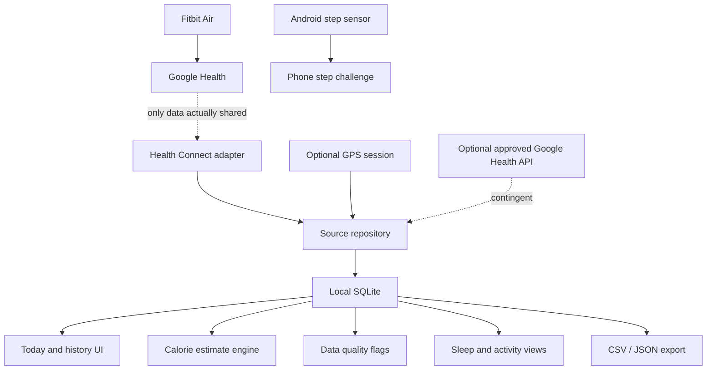

# Becel — Fitbit Air Companion App Goal

**Status:** Product and engineering direction  
**Platform:** Android first; Flutter/Dart UI with Kotlin integrations where Android APIs require them  
**Last researched:** 18 October 2026

## 1. Product goal

Build **Becel**, a trustworthy Android companion for people who use Fitbit Air and Google Health. Becel makes available health and activity data easier to inspect, compare, and keep over time. It adds transparent estimates and user-controlled tools without pretending to replace Google Health, claim supported Fitbit Air control, or provide medical care.

The product promise is: **show what was measured, what Becel calculated, which data was used, how fresh it is, and where uncertainty remains.** Fitbit Air and Google Health are external product names; Becel is an independent app and must not imply endorsement or affiliation.

The first release is a useful data companion. It is not a numerical or visual clone of Bevel. Bevel’s score-led coaching experience is a reference for possible later wellness features, but Becel will use its own interface, methods, naming, and disclosed limitations.

## 2. Users and problems to solve

Primary users are Fitbit Air owners who want more inspectable data and tools around their Google Health data.

Product hypotheses from the supplied companion plan and public user reports:

- Users may find activity totals, workout labels, or calorie estimates hard to trust or explain.
- Health metrics can be delayed, unavailable, or present only as summaries.
- Users want stable history, context, and a way to export their records.
- Sleep and workout classification may need user annotations or corrections.
- Some users want a configurable alarm challenge that takes more than one tap to dismiss.
- Users may want an independent calorie estimate, but should be able to compare it with the source estimate and understand its assumptions.

These are hypotheses, not prevalence claims. Do not describe them as proven device defects or promise that Becel can correct the source device’s measurements.

## 3. Product principles

1. **Preserve source records.** Never silently rewrite or delete imported measurements. Store annotations and derived estimates separately.
2. **Provenance on every value.** Record source, unit, timestamps, import time, and whether a value is measured, user-entered, or estimated.
3. **No false precision.** Estimates include assumptions and uncertainty; missing values are not zero.
4. **Local-first.** No account or backend is required for MVP. Any later cloud feature must have a clear user benefit and explicit privacy design.
5. **Graceful partial data.** The app remains useful if a metric is unsupported, permission is denied, or syncing is late.
6. **Feasibility before feature promises.** Verify Fitbit Air data access on a real device before making a metric a requirement.
7. **Alarm fallback.** The phone-side alarm works independently of Fitbit Air connectivity. Wrist haptics are experimental and optional.
8. **Wellness, not diagnosis.** No diagnosis, treatment advice, or unsupported clinical claims.
9. **Explain decisions.** Anomaly flags are review cues, not automatic edits or accusations of inaccurate data.
10. **Use evidence responsibly.** Product features and hardware capabilities need primary or direct sources; hypotheses and design choices are marked as such.

## 4. Scope and priorities

### P0 — MVP foundation

- Device and source capability diagnostics, including Health Connect availability and permissions.
- Read supported Health Connect records after the user grants access.
- Source adapters so additional access methods can be added without coupling the UI to one provider.
- Local database, idempotent import, provenance, deletion handling where supported, and sync status.
- Today dashboard for available steps, activity, heart rate, sleep, workouts, and energy metrics.
- Data freshness, gaps, permissions, source and missing-data states.
- Daily and weekly history with metric detail and date navigation.
- CSV and JSON export; delete locally stored Becel data.
- Transparent calorie estimate v1 with gross and active energy separated, plus source estimate comparison when available.
- Conservative activity data-quality flags that preserve the original value.
- Android phone-side configurable step challenge alarm, subject to Android permissions and device capabilities; ordinary stop/fallback controls remain available.
- Privacy screen, diagnostics without sensitive health values, and accessible UI.

### P1 — Core expansion after MVP data access is proven

- Sleep timeline using only imported stages; notes and user annotations for sleep boundaries and naps.
- Workout list, manual workout entry, and user correction of activity type without changing source records.
- HRV and resting-heart-rate trends where records are available and sufficiently complete.
- GPS workout recording with foreground notification and explicit location controls.
- Manual treadmill distance correction and GPS quality display.
- Configurable heart-rate threshold alerts, with limits and background behavior clearly stated.
- More robust, user-reviewable anomaly flags after a labeled example set exists.
- Optional home-screen widgets and phone reminders.

### P2 — Later, contingent on user need and evidence

- Editable food diary and deterministic macro arithmetic.
- Summaries grounded in available records, with missing-data disclosures; no AI coach in MVP.
- Optional backup/sync service only after threat modeling and a privacy case.
- Google Health API adapter only if project onboarding, scopes, OAuth verification, terms, and user access are confirmed.
- Additional behavior-equivalent wellness scores (for example sleep or recovery summaries) only after the inputs, calibration, and score interpretation are validated. Scores must be labeled as Becel estimates, not Bevel scores.

### Out of scope unless separately approved

- Production management of Fitbit Air firmware, general alarms, or settings. The user-requested one-shot wrist test is implemented as a debug-only experiment and remains gated from release builds under section 10.
- Guaranteed live sensor streaming or guaranteed third-party Bluetooth coexistence with Google Health.
- Reverse-engineered Bluetooth commands as a production dependency.
- Guaranteeing that users cannot silence or bypass the phone alarm.
- Medical diagnosis, treatment, or claims of clinical accuracy.
- Copying Bevel branding, proprietary assets, or presenting Becel scores as equivalent to Bevel.
- Mandatory cloud accounts or a paid subscription in the initial release.

## 5. Data access strategy and feasibility gates

### 5.1 Primary candidate: Health Connect

Health Connect is a local Android data store and a candidate import source, not a guaranteed Fitbit Air integration. Android documentation says Health Connect is available on Android 9+ with Google Play services; users grant per-data-type permissions. Historical reads beyond the default 30 days require an additional permission when supported, and background reads require a separate permission. Data availability depends on what Google Health actually writes to Health Connect and what the user grants.

Therefore:

- Build a small proof of concept before committing the dashboard or scoring roadmap to any specific Fitbit Air metric.
- On target hardware, record which Health Connect types are present, their provenance, sample resolution, date range, update delay, and behavior after revocation/regrant.
- Query only granted data types and available history. Do not assume 60-day baselines or full-fidelity intraday HR.
- Sync on app foreground/resume and through appropriately permitted background work; WorkManager is deferrable and is not a real-time 15-minute guarantee.
- Use the Health Connect Changes API only where supported and appropriate; handle token invalidation, deletions, interrupted reads, and duplicate records.
- Treat user-selected source priorities and aggregation behavior as possible causes of differences in aggregate data.

The current app uses an Air-only display filter: it accepts only the Fitbit app (`com.fitbit.FitbitMobile`) and Google Health source packages, then checks device manufacturer/model metadata when it is present. Metadata written by an actual paired Fitbit Air was confirmed on target hardware (October 2026): steps and heart-rate records synced by the Fitbit app carry no device metadata, and sleep/exercise records carry only a model string ("Fitbit Air" or "Google Fitbit Air") with no manufacturer. The filter therefore accepts Fitbit-app records with no device identity, accepts Fitbit/Google manufacturer plus Air-model combinations when metadata is present, rejects any record whose device metadata names another device, and always rejects other source packages. Step totals are calculated only from accepted records, and live screens contain no sample health values. Health Connect device metadata is optional and source-app supplied, so this match is an attribution check rather than cryptographic proof that the physical band produced the record.

### 5.2 Optional candidate: Google Health API

Google’s current developer documentation describes the Google Health API as successor infrastructure for Fitbit data, but explicitly says it is **not onboarding new projects at this time**. It also says updates are available only after tracker sync, with automatic Fitbit/Google Health sync described as possible about every 15 minutes while the app is open, connected, and in Bluetooth range. This does not establish a Becel project’s eligibility, access approval, backfill range, or webhook entitlement.

Accordingly, do not make the Google Health API a launch dependency. Before starting an adapter, verify project enablement, current developer terms, OAuth scopes/verification, supported Air data types, rate limits, history behavior, and webhook configuration for Becel’s own project. Keep API credentials and refresh tokens out of the client where applicable. Do not claim that cloud access bypasses Health Connect’s limits unless the API contract and approved project confirm it.

### 5.3 Legacy Fitbit Web API

Google’s current documentation states that the Fitbit Web API will turn off on **30 October 2026**. Do not start a new long-term integration on that API. Recheck the migration documentation at implementation time because dates and access rules can change.

### 5.4 Source adapter contract

Each data source reports capabilities, permissions, sync status, and errors explicitly. Conceptual interface:

```dart
abstract interface class HealthDataSource {
  String get sourceId;
  Future<SourceCapabilities> getCapabilities();
  Future<PermissionStatus> requestPermissions(Set<MetricType> metrics);
  Future<SyncResult> sync(SyncWindow window);
}
```

An unsupported metric must be represented as unsupported, not as an empty or fabricated reading.

## 6. Data and persistence requirements

Use a local SQLite-backed store (Drift or another maintained Flutter solution) with migrations. Normalize units and UTC timestamps while preserving original value, source identity, original timestamps, and available timezone/offset metadata.

Core entities:

- **Source record:** source, source record ID if supplied, metric/type, value, unit, start/end time, import time, origin/device metadata where available, quality flags, and safe raw payload only when justified.
- **Derived metric:** metric, value/unit, time window, algorithm name/version, input record IDs, assumptions, and uncertainty label.
- **User annotation:** target interval/record, corrected label or note, author (user), and audit timestamps.
- **Sync state:** source/type, last attempt/success, cursor/token if supported, and sanitized error code.
- **Alarm configuration:** schedule, repeat days, step goal, sound/vibration, maximum duration, and fallback controls.

Rules:

- Store times in UTC; render in the user’s local zone and handle daylight-saving/timezone changes.
- Never interpret absence of a sample as zero.
- Deduplicate by provider record ID when available; otherwise use a documented stable composite key.
- Preserve corrected or deleted-source semantics when the provider exposes them.
- Do not log raw health values or sensitive routes in production diagnostics.
- Export and deletion must include Becel-derived data and clearly state what remains in Google Health/Health Connect.

## 7. Product features and UX

### Navigation

1. **Today:** available daily metrics, last update, recent sleep/workout, estimated vs imported energy.
2. **History:** calendar/date selector and daily/weekly timelines.
3. **Activity:** imported workouts, manual entries, optional GPS sessions and annotations.
4. **Sleep:** sessions, imported stages, gaps and notes.
5. **Data quality:** missing periods, provenance, suspicious intervals, permissions and source status.
6. **Alarm:** schedule, challenge length, progress, sound/vibration and fallback configuration.
7. **Settings:** connected sources, units, privacy, export, local deletion and diagnostics. Debug builds also expose the experimental Fitbit Air haptic test.

### UX behavior

- Every value shows a unit and can be opened to inspect source, freshness, interval, and history.
- Mark estimates and manual entries clearly; distinguish them visually and in exports.
- Include loading, empty, unsupported, stale, permission-denied, sync-error, and partial-data states.
- Never rely on color alone. Support large text, screen readers, and accessible chart summaries.
- Use a restrained dark/light system with a distinct Becel identity. Do not reproduce Bevel’s exact interface or assets.

## 8. Calorie estimate requirements

Calorie values are estimates. The app must preserve imported energy records and show Becel calculations separately. Use a documented activity MET reference (initial candidate: 2024 Adult Compendium) and store reference/version with the algorithm. Do not call the Fitbit Air estimate “wrong” simply because it differs.

For a MET-based baseline:

```text
gross kcal  = MET × 3.5 × weight_kg / 200 × duration_minutes
active kcal = max(MET − 1, 0) × 3.5 × weight_kg / 200 × duration_minutes
```

Inputs and behavior:

- Require valid duration and a recent, sourced body-weight value for the baseline; disclose if a fallback is used.
- Map activity type to a documented MET range/value; avoid using one universal intensity.
- Treat HR, pace, cadence, distance, grade, and user corrections as optional context, not proof of energy expenditure.
- Personalize from HR only after calibration and validation, with signal coverage/quality checks.
- Return gross and active estimates, inputs, source, algorithm version, and a plain-language uncertainty note.
- Flag contradictory duration/distance/pace/cadence or insufficient HR coverage without overwriting input records.
- Validate against hand-calculated fixtures and, before accuracy claims, a representative reference dataset. Do not imply indirect-calorimetry accuracy without such validation.

## 9. Activity data-quality feature

Initial anomaly detection should be simple, explainable, and non-destructive. Potential flags include unusual step rate, impossible duration/distance combinations, overlapping sessions, abrupt source gaps, or activity totals inconsistent with available samples. Thresholds require labeled real examples and should be configurable/calibrated.

The interface should say “review this interval” and show the evidence. Users may confirm, dismiss, annotate, or compare with another source. Never silently subtract steps or change a source value. Report validation results and false-positive rates internally before presenting the feature as reliable.

## 10. Alarm feature requirements

The configurable step challenge is a **phone-side alarm**. A 500-step goal is a default suggestion from the supplied plan, not a hard-coded requirement. Users can choose the target and retain a clear stop/fallback path for safety, accessibility, sensor failure, or emergency.

Android implementation considerations:

- Use Android alarm APIs for user-scheduled alarm events; request exact-alarm capability only if justified and handle denial/revocation. Android documentation distinguishes exact alarms from deferrable WorkManager work.
- Full-screen alarm intents are restricted on Android 14+ to apps whose permitted core use is calling or alarms; verify Google Play eligibility and runtime permission state. A full-screen activity is not a device lock, and users retain OS controls.
- Request `ACTIVITY_RECOGNITION` for step-counter sensor access on Android 10+; `TYPE_STEP_COUNTER` may have up to 10 seconds latency and depends on device sensor support.
- Count steps relative to a baseline captured when the challenge starts; persist and restore challenge state. Do not depend on a raw all-day step total.
- Provide an audible/notification fallback and safe dismissal if the sensor is absent, permission is denied, app process is killed, or the device restarts.
- Test screen-off behavior, battery restrictions, reboot, notification permission, volume/DND, OEM variants, and exact-alarm access on real target phones.
- Do not advertise “inescapable”, “cannot be silenced”, or guaranteed 500-step enforcement.

### Fitbit Air wrist haptics

The user explicitly requested a Fitbit Air vibration test initiated entirely from Becel; a phone vibration or handoff to Google Health does not meet that requirement. Becel now contains a debug-build-only prototype adapted from the community Apache-2.0 Golden Gate bridge. It scans for Fitbit Golden Gate devices, asks the user to select the Air, briefly toggles the private `/settings` haptics value, restores the saved value, and verifies it. Scanning retries while the band is unavailable; a changed Bluetooth address is accepted only when a single Air-named Golden Gate device is visible. After the pulse, Becel closes its own BLE connection so Google Health may reconnect. Users should not have to unpair the Air, but Becel cannot force Google Health to release its connection or guarantee Health's reconnection. The reported protocol was validated on one Air, not on this Becel build. It relies on private BLE/DTLS behavior and may briefly delay syncing. Fitbit's platform terms prohibit reverse-engineering or interference and require an agreement for unsupported use cases. Therefore this experiment is hidden in release builds and is not an alarm, notification guarantee, or production feature. Do not publish or enable it in a release until legal authorization, license review, security review, coexistence, reliability, and target-device testing are resolved. Never substitute phone vibration for this app-only wrist test.

## 11. Technical architecture



Flutter owns presentation, repositories, normalized models, local persistence, and portable calculation logic. Kotlin is reserved for Android-specific Health Connect integration if the selected Flutter package cannot meet requirements, alarm lifecycle, sensors, permissions, and optional Bluetooth experiments. Keep platform code behind narrow interfaces.

Background work is best-effort and permission-dependent. Do not promise real-time ingestion, a fixed 15-minute polling cadence, or immediate morning scores. Show last successful import and let foreground refresh recover from missed background work.

## 12. Milestones and exit gates

### Milestone 0 — Feasibility (before substantial feature implementation)

- Confirm target handset model, Android release, Google Health version, Health Connect availability, and Fitbit Air pairing.
- Inventory the Health Connect records actually produced by a real Fitbit Air: data types, source metadata, sample granularity, history, and update delays.
- Check permission behavior and whether background/historical reads are supported on that installation.
- Check Google Health API project onboarding for Becel; confirm docs/terms and test-project access, if available.
- Prototype step sensor and alarm behavior on the target phone.
- Keep the direct Bluetooth haptic test isolated to debug builds. With the Air paired in Google Health, measure discovery and availability while Health is idle, syncing, foregrounded, and backgrounded; verify the original haptics setting is restored, Becel releases its BLE connection, and Health resumes syncing without unpairing. Record wait time, failures, and reconnection behavior. Treat discovery retries as best effort; do not claim Becel can force Health to release the band.

**Exit:** written capability report with screenshots/logged type names (no sensitive values), reproducible sample import, and a go/no-go for each candidate data source. If Fitbit Air data is unavailable, revise product scope before promising Air-specific analysis.

### Milestone 1 — Data foundation

- Flutter app shell, source diagnostics, permission rationale, adapter interface, database schema/migrations.
- Import a bounded time range idempotently; preserve provenance and sync diagnostics.
- Add export and local deletion.

**Exit:** repeat imports create no duplicates; denied/revoked permissions recover cleanly; missing data is not shown as zero; source values can be inspected and exported.

### Milestone 2 — MVP dashboard and history

- Today, history, metric details, freshness, partial-data and error states.
- Build only cards for metrics confirmed available in Milestone 0.

**Exit:** manually compare app display and exported records against source data for representative cases and date/time boundaries.

### Milestone 3 — Calorie and quality engines

- Implement MET baseline, gross/active separation, provenance, uncertainty, and explainable flags.
- Add replay fixtures and user review flow.

**Exit:** calculation fixtures match independently computed results within rounding tolerance; estimates never replace source values; anomaly behavior is documented and reviewed against labeled examples.

### Milestone 4 — Alarm prototype and core expansion

- Implement phone-side alarm and relative step goal with safe fallback.
- Add sleep timeline, workout annotations, and optional GPS only after MVP stability.

**Exit:** alarm test matrix covers supported target devices and known failures; it works without Fitbit Air; users can stop it if sensor or permission support fails.

### Milestone 5 — Private beta readiness

- Verify migrations, privacy notice, export/delete, accessibility, crash diagnostics, and device coverage.
- Document supported metrics, delays, unavailable sources, and known limitations.

**Exit:** no known data-loss issue in tested import/export/delete flows; no copy or diagnosis claims; release notes describe actual, tested capabilities.

## 13. Post-MVP roadmap

After feedback and reliable imports: sleep/workout refinements, trend summaries, user-calibrated recovery/sleep insights, optional food log, widgets, and optional backup. Add AI summaries only if they cite the records they use, disclose missing data, and avoid medical advice. Add cloud/API support only after access, policy, privacy, security, and cost feasibility are established. Prioritize with user evidence rather than attempting feature parity with another app.

## 14. Acceptance criteria for MVP

- App can clearly report supported/unsupported metrics and current permissions.
- Imported values preserve provenance, units, timestamps, and source identity when available.
- Dashboard/history work with incomplete data and show freshness.
- Re-sync does not duplicate records; source corrections/deletions are handled where supported.
- Export and local deletion work and explain that they do not erase Google Health data.
- Imported calorie values and Becel estimates remain separate; estimate assumptions and version are inspectable.
- Quality flags never alter source records.
- Alarm works without a connected band, handles unavailable sensor/permission safely, and never claims to lock the phone or guarantee compliance.
- Sensitive health values are absent from production logs.
- Screens have empty/error/permission states and accessible labels.
- Real-device test report documents tested phones, Android versions, data availability, alarm behavior, and limitations.

## 15. Key risks and responses

| Risk | Response |
|---|---|
| Fitbit Air data is absent or too summarized in Health Connect | Validate first; ship only supported data; reconsider Air-specific value if core data is unavailable. |
| Google Health API onboarding remains closed | Keep it optional; use only verified Health Connect data or revise product assumptions. |
| Sync is delayed or background work is deferred | Show freshness and refresh on foreground; do not promise real-time coaching. |
| Historical reads are permission/version limited | Request only if needed and supported; disclose actual range; avoid assuming long baselines. |
| Bluetooth haptics handoff can delay Google Health reconnection | Wait for Air advertisements, close Becel's connection after each test, and validate coexistence with Google Health on paired hardware; keep haptics experimental. |
| Android alarm permissions or full-screen behavior vary | Handle denied permissions and OEM behavior; retain user controls and fallback. |
| Calorie estimates are inaccurate for an individual | Label estimates and uncertainty; preserve source values; validate before claims. |
| Anomaly flags frustrate users | Make flags explainable and reversible; measure false positives; never auto-correct. |
| Health data is exposed | Local-first, minimum permissions, sanitized logs, explicit export/delete, secure any future tokens. |
| Scope expands into a Bevel clone | Keep primary roadmap focused on companion utility; validate later features with users. |

## 16. Research notes and primary references

External platform behavior can change. Recheck sources before implementation and release. Research here verifies platform/API constraints; it does not establish that every listed Fitbit Air metric is actually present on a particular phone.

- [Google Health API overview and onboarding status](https://developers.google.com/health) — states projects are not currently being onboarded and gives Fitbit Web API shutdown timeline.
- [Google Health paired-device API](https://developers.google.com/health/reference/rest/v4beta/users.pairedDevices) — exposes device metadata and alarm capability; the documented methods are get/list.
- [Fitbit Web API Create Alarm](https://dev.fitbit.com/build/reference/web-api/devices/create-alarm/) — model-limited legacy alarm endpoint; verify Air support and current status before any use.
- [Fitbit Platform Terms](https://dev.fitbit.com/new-developer/) — governs Fitbit platform access and calls out unsupported use cases and reverse engineering.
- [Google Fitbit Air alarm help](https://support.google.com/googlehealth/answer/14226604) — documents the supported alarm setup path in Google Health and wrist vibration at alarm time.
- [Unofficial Fitbit Air haptics bridge](https://github.com/paceaitian/fitbit-air-notification-bridge) — community experiment only; not a supported or approved Becel integration.
- [Google Health API device compatibility](https://developers.google.com/health/data-types/device-compatibility) — device/type compatibility reference; verify supported metric table and project availability when building.
- [Google Health API data types and data availability](https://developers.google.com/health/data-types) — data updates depend on tracker sync; describes possible ~15-minute sync conditions.
- [Android Health Connect availability](https://developer.android.com/health-and-fitness/health-connect/availability) — Android version and Play services requirements.
- [Health Connect permissions and setup](https://developer.android.com/health-and-fitness/health-connect/get-started) — per-type user permissions.
- [Health Connect data types and additional read permissions](https://developer.android.com/health-and-fitness/health-connect/data-types) — background and history permission declarations.
- [Health Connect read behavior and history limits](https://developer.android.com/health-and-fitness/health-connect/read-data) — background reads, historical access, default 30-day limit.
- [Health Connect sync guidance](https://developer.android.com/health-and-fitness/health-connect/sync-data) — changes sync/background reads and lack of automatic new-data notification.
- [Android alarm scheduling](https://developer.android.com/develop/background-work/services/alarms) — exact alarm permissions and deferrable work guidance.
- [Android 14 full-screen intent limits](https://developer.android.com/about/versions/14/behavior-changes-14) — full-screen intent eligibility and user control.
- [Android motion sensors](https://developer.android.com/develop/sensors-and-location/sensors/sensors_motion) — step counter permission and latency.
- [2024 Adult Compendium of Physical Activities](https://pacompendium.com/) — candidate MET reference; confirm licensing/attribution and mapping before use.
- [Flutter platform channels](https://docs.flutter.dev/platform-integration/platform-channels) — Flutter/native integration reference.

The supplied `gemini_finding.md` is treated as an idea source, not an authoritative verification source. Its claims that Fitbit Air alarm internals, double-tap behavior, call-alert loops, direct GATT controls, specific chipset limits, or exact vibration battery impacts are verified should not be carried forward without direct primary evidence and device tests.

## 17. Immediate next actions

1. Run Milestone 0 on the actual Fitbit Air and target Android phone; record data availability and latency.
2. Confirm current Google Health API onboarding and terms for this project; do not build against it until access exists.
3. Build the narrow import diagnostic and provenance-preserving local store.
4. Implement Today/history for only confirmed types.
5. Add calorie estimates and reviewable quality flags with transparent assumptions.
6. Prototype the phone alarm on the actual target handset with permission and failure handling.
7. Validate the debug-only wrist haptic handoff on the user's Air while it remains paired to Google Health. Confirm pulse delivery, restoration, Becel disconnect, and Health reconnection across idle/sync/foreground/background cases; resolve authorization, coexistence, and reliability before considering any release build support.
